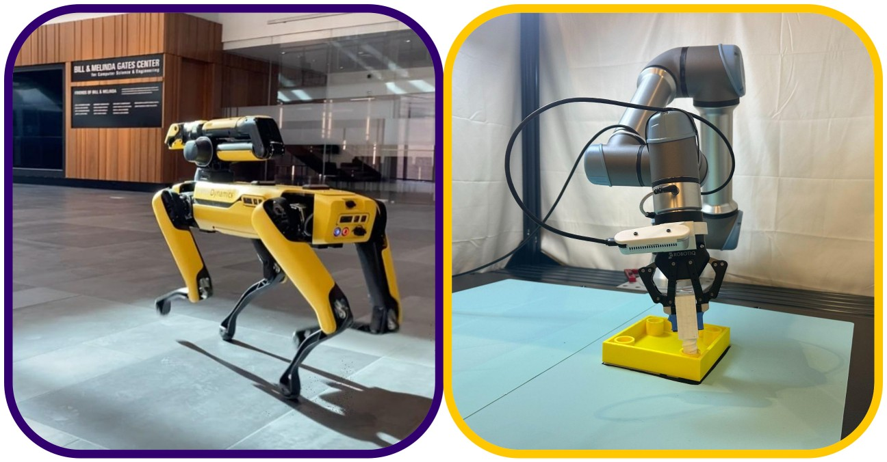

# UW Lab

[](https://docs.isaacsim.omniverse.nvidia.com/latest/index.html)
[](https://docs.python.org/3/whatsnew/3.11.html)
[](https://releases.ubuntu.com/20.04/)
[](https://www.microsoft.com/en-us/)
[](https://github.com/isaac-sim/IsaacLab/actions/workflows/pre-commit.yaml)
[](https://github.com/isaac-sim/IsaacLab/actions/workflows/docs.yaml)
[](https://opensource.org/licenses/BSD-3-Clause)

> [!NOTE]
> **This is the `asteroid` branch.** It adds ASTEROID on top of UW Lab temporarily, based on the
> Isaac Sim 5.1 / Isaac Lab 2.x version of UW Lab. ASTEROID will be merged back into `main` after it
> is upgraded to Isaac Lab 3.0. The UW Lab README follows the ASTEROID section.

## ASTEROID

**Asymmetric On-Policy Distillation Learns In-Context Exploration**<br>
Sriyash Poddar, Yanda Bao, Jacob Krantz, Matthew Chang, Xavier Puig, Roozbeh Mottaghi, Natasha Jaques, Abhishek Gupta

[Project page](https://weirdlabuw.github.io/asteroid/) ·
[Paper](https://weirdlabuw.github.io/asteroid/Incontext_Exploration___NeurIPS2026__arxiv_.pdf) ·
[Official codebase](https://github.com/WEIRDLabUW/asteroid)

Experts don't explore, so imitating them can't teach exploration. In a partially observed
task, a privileged expert already knows the answer, while a student that can't see it has to
probe, remember what failed and try again. ASTEROID lets the student explore on-policy and
asks the expert one question: *given what this student has experienced so far, what would you
do?* Each iteration, the student acts for a random number of steps to build up its own
context, the expert takes over from wherever the student ended up to label actions, and the
student is trained to map its history and current observation to the expert's action. The
same history can call for different actions in different worlds, so the student learns a
distribution over expert actions, and the hand-off points move later over iterations, giving
a natural curriculum over context length.

This branch contains the **tactile cube pick-up** experiments: a UR5e + Robotiq 2F-85 student
that sees only proprioception (arm joints, end-effector pose, gripper width, last actions; no
camera) learns to probe, feel for contact and retry after a missed grasp. The privileged
expert is a state-based RL policy trained with the OmniReset recipe; the student is a
diffusion-policy transformer over its own trajectory. `scripts/ASTEROID/run_asteroid.py` runs
the loop, and each iteration has three stages:

1. **collect**: the previous student explores for a random fraction of each episode, then the
   expert takes over; observations, actions and a per-step expert mask are recorded.
2. **train**: fit the student on every dataset collected so far.
3. **eval**: roll out the student.

Code lives in [`scripts/ASTEROID`](scripts/ASTEROID) and
[`source/uwlab_tasks/.../manipulation/asteroid`](source/uwlab_tasks/uwlab_tasks/manager_based/manipulation/asteroid).
The full guide, with every environment, the dataset layout and the package layout, is
[`docs/source/publications/asteroid/index.rst`](docs/source/publications/asteroid/index.rst).

### Setup

Install UW Lab from this branch following the
[pip installation guide](docs/source/setup/installation/pip_installation.rst) (Isaac Sim 5.1),
then fetch the diffusion-policy submodule:

```bash
git clone -b asteroid https://github.com/UW-Lab/UWLab.git && cd UWLab
git submodule update --init diffusion_policy
```

### Quick start

All tasks are pick-only variants of the OmniReset UR5e + Robotiq 2F-85 tasks. Success means
the cube is lifted with the gripper pointing down. Reset states and grasps are read from
`Datasets/CubePick` (override with `ASTEROID_DATASETS_DIR`).

**1. Record reset states**, then repeat with `ObjectRestingEEGrasped` and
`ObjectAnywhereEEGrasped`. These two also need a grasp dataset; see the OmniReset
[RL training guide](docs/source/publications/omnireset/rl_training.rst).

```bash
python scripts_v2/tools/record_reset_states.py \
    --task Asteroid-UR5eRobotiq2f85-ObjectAnywhereEEAnywhere-v0 \
    --dataset_dir Datasets/CubePick --num_envs 64 --num_reset_states 1000 --headless \
    env.scene.insertive_object=cube
```

**2. Train the state expert in two stages.** Stage 1 uses soft pre-training gains. Stage 2
(*Finetune*) resumes from Stage 1, and a curriculum ramps system-identification
randomization, OSC gains and action scales to the values the student is collected and
evaluated with.

```bash
# Stage 1
python scripts/reinforcement_learning/rsl_rl/train.py \
    --task Asteroid-Ur5eRobotiq2f85-RelCartesianOSC-State-v0 \
    --num_envs 4096 --headless env.scene.insertive_object=cube

# Stage 2: finetune from the Stage 1 checkpoint
python scripts/reinforcement_learning/rsl_rl/train.py \
    --task Asteroid-Ur5eRobotiq2f85-RelCartesianOSC-State-Finetune-v0 \
    --num_envs 4096 --headless env.scene.insertive_object=cube \
    --resume_path logs/rsl_rl/ur5e_robotiq_2f85_asteroid_agent/<stage1_run>/model_<n>.pt

# Evaluate the Stage 2 expert; this also exports <run>/exported/policy.pt
python scripts/reinforcement_learning/rsl_rl/play.py \
    --task Asteroid-Ur5eRobotiq2f85-RelCartesianOSC-State-Finetune-Play-v0 \
    --num_envs 1 env.scene.insertive_object=cube \
    --checkpoint logs/rsl_rl/ur5e_robotiq_2f85_asteroid_agent/<stage2_run>/model_<n>.pt
```

**3. Run ASTEROID** in the Finetune tactile environments:

```bash
python scripts/ASTEROID/run_asteroid.py \
    --data_task Asteroid-Ur5eRobotiq2f85-RelCartesianOSC-Tactile-Finetune-DataCollection-v0 \
    --eval_task Asteroid-Ur5eRobotiq2f85-RelCartesianOSC-Tactile-Finetune-Play-v0 \
    --expert_policy_checkpoint logs/rsl_rl/ur5e_robotiq_2f85_asteroid_agent/<stage2_run>/exported/policy.pt \
    --config_name in_context_exploration_tactile_base.yaml \
    --num_demos 32768 --num_data_envs 512 --num_eval_envs 1 --num_eval_episodes 20 \
    --max_iterations 6 --exp_name cube_asteroid --no_video
```

Each run writes `run_cfg.json` (the full hyperparameter tree), plus a dataset and student
checkpoints for every iteration. Useful options:

- `--dry_run` prints every stage's command without launching Isaac Sim.
- `--start_iteration N --checkpoint_dir <run dir>` resumes an interrupted run.
- Per-iteration hyperparameters (exploration horizons, learning rates, dataset sampling
  ratios) are dataclasses in `run_asteroid.py`. Add a curriculum to `CURRICULA` and select
  it with `--schedule`.
- On a multi-GPU machine the simulator uses `--device` and the student runs on the other
  GPUs.


## Overview

UW Lab builds upon the robust foundation established by Isaac Lab and NVIDIA Isaac Sim, expanding its framework to integrate a wider range of robotics algorithms, platforms, and environments. Rooted in principles of modularity, agility, openness, and a battery-included design inspired from IsaacLab, our framework is crafted to meet the evolving demands of modern robotics research.

In the short term, our mission is to consolidate and streamline robotics research into one cohesive ecosystem, empowering researchers and developers with a unified platform. Looking ahead, UW Lab envisions a future where artificial intelligence and robotics coalesce seamlessly with physical systems—bridging the gap between simulation and real-world application. By embedding the laws of physics at its core, our framework provides a realistic, adaptable platform for developing next-generation robotic systems.

At UW Lab, we believe that the development journey is as significant as the outcome. Our commitment to creating principled, flexible, and extensible structures supports an environment where innovation thrives and every experiment contributes to advancing the field of robotics. Join us as we push the boundaries of what's possible, transforming ideas into tangible, intelligent robotic solutions.


## Key Features

In addition to what IsaacLab provides, UW Lab brings:

- **Environments**: Cleaned Implementation of reputable environments in Manager-Based format
- **Sim to Real**: Providing robots and configuration that has been tested in Lab and deliver the Simulation Setup that can directly transfer to reals


## Installation

Follow the [installation guide](https://uw-lab.github.io/UWLab/main/source/setup/installation/index.html).


## Getting Started

- **Train Your First Policy** — Train an ant to run in minutes → [Quickstart](https://uw-lab.github.io/UWLab/main/source/setup/installation/pip_installation.html#train-a-robot)
- **OmniReset** — RL for manipulation without reward engineering or demos → [Quickstart](https://uw-lab.github.io/UWLab/main/source/publications/omnireset/index.html#quick-start)
- **ASTEROID** — Asymmetric on-policy distillation that learns in-context exploration → [Quickstart](#quick-start) (this branch)

See [all available environments](https://uw-lab.github.io/UWLab/main/source/overview/uw_environments.html) and [full documentation](https://uw-lab.github.io/UWLab) for details.


## Support

* Please use GitHub [Discussions](https://github.com/uw-lab/UWLab/discussions) for discussing ideas, asking questions, and requests for new features.
* Github [Issues](https://github.com/uw-lab/UWLab/issues) should only be used to track executable pieces of work with a definite scope and a clear deliverable. These can be fixing bugs, documentation issues, new features, or general updates.


## License

UW Lab is released under [BSD-3 License](LICENSE)
The Isaac Lab framework is released under [BSD-3 License](LICENSE).
